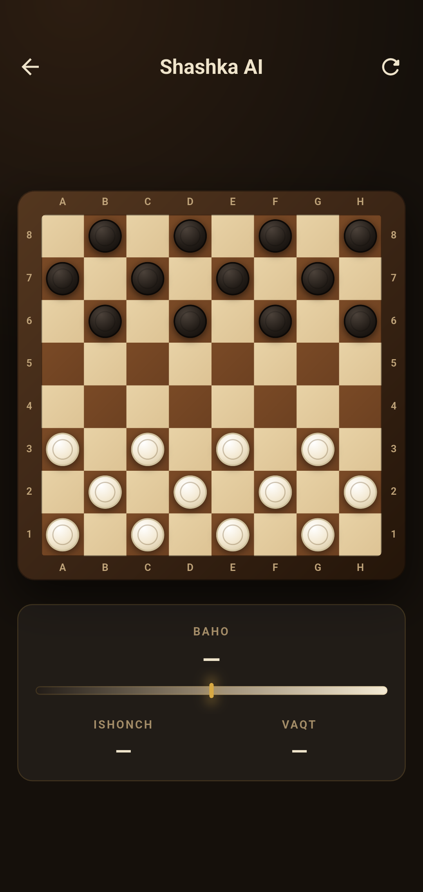
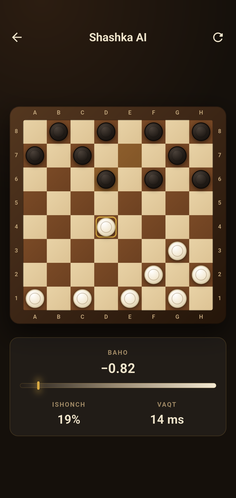
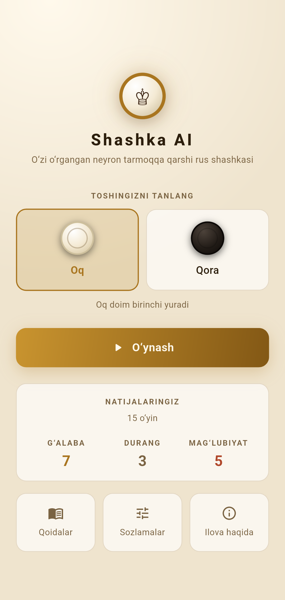
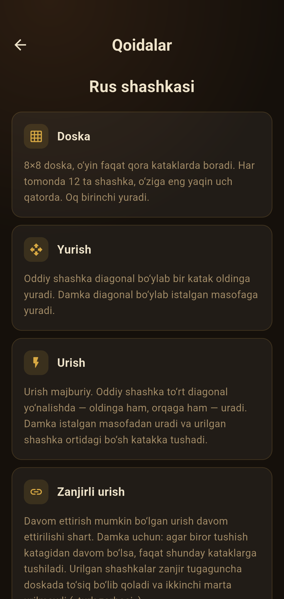

<div align="center">


# Shashka AI

**Rus shashkasi — o‘zi o‘rgangan neyron tarmoqqa qarshi.**
Internetsiz, ro‘yxatdan o‘tishsiz, reklamasiz. Tarmoq to‘liq telefoningizda ishlaydi.


</div>

---

<div align="center">
<table>
<tr>
<td align="center"><br><sub><b>O‘yin boshlandi</b></sub></td>
<td align="center"><br><sub><b>Baho · ishonch · vaqt</b></sub></td>
<td align="center"><br><sub><b>Yorug‘ rejim</b></sub></td>
<td align="center"><br><sub><b>Qoidalar</b></sub></td>
</tr>
</table>
</div>

---

## Nima bu

Raqib — AlphaZero uslubida **faqat o‘zi bilan o‘ynab** o‘rgangan transformer
neyron tarmoq: inson partiyalari ham, debyut kitobi ham, qo‘lda yozilgan baho
funksiyasi ham ishlatilmagan. Barcha g‘oyalarni — qurbon berish, zanjirli
urish, damka bilan ishlash — u o‘zi kashf qilgan.

Tarmoq telefonda, ONNX Runtime orqali ishlaydi. Har yurish **~10 ms** — kutish
oynasi yo‘q, javob bir zumda keladi.

| | |
|---|---|
| 🧠 | Haqiqiy neyron tarmoq, qurilmada. Server yo‘q, internet ruxsati **umuman so‘ralmaydi** |
| ⚡ | Yurish ~10 ms. Hisob-kitob alohida isolate'da — interfeys hech qachon muzlamaydi |
| 📊 | Har yurishda **baho**, **ishonch** va **vaqt** ko‘rsatiladi |
| 🌓 | Yorug‘ va to‘q rejim (yoki tizimdagidek) |
| 🌐 | O‘zbek · Rus · Ingliz |
| ♟ | To‘liq rus shashkasi qoidalari — majburiy urish, zanjir, damka, turk zarbasi |
| 🔒 | Akkaunt yo‘q, analitika yo‘q, reklama yo‘q |

---

## Ishga tushirish

> [!IMPORTANT]
> Neyron tarmoq vaznlari bu repozitoriyda **saqlanmaydi**. Birinchi qadam —
> modelni qadoqlash. Usiz loyiha kompilyatsiya bo‘lmaydi
> (`Target of URI doesn't exist: 'model_key.dart'`).

**1 — Modelni qadoqlash**

`checkpoints/best.onnx` (+ `best.onnx.data`) bitta faylga birlashtiriladi,
shifrlanadi va `assets/models/model.bin` ga yoziladi. Shu bilan birga
`lib/core/ai/model_key.dart` yaratiladi.

```bash
pip install onnx
python3 tool/pack_model.py
```

**2 — Bog‘liqliklar**

```bash
flutter pub get
```

**3 — Ishga tushirish**

```bash
flutter run --release
```

<details>
<summary><b>Release qurish (Google Play uchun)</b></summary>

<br>

Avval imzo kaliti:

```bash
cd android
keytool -genkey -v -keystore upload-keystore.jks -storetype JKS \
  -keyalg RSA -keysize 2048 -validity 10000 -alias upload
cp key.properties.example key.properties
```

Keyin:

```bash
flutter build appbundle --release --obfuscate --split-debug-info=build/symbols
```

`build/symbols/` — obfuskatsiyalangan crash-loglarni o‘qish uchun. Har reliz
bilan birga zaxiralang. `upload-keystore.jks` ni yo‘qotsangiz, ilovaga
yangilanish chiqara olmaysiz.

To‘liq qo‘llanma: [`docs/play/README.md`](docs/play/README.md)

</details>

---

## Qanday ishlaydi

```mermaid
flowchart LR
    subgraph UI["UI isolate"]
        B[BoardView] <--> G[GameController]
    end
    subgraph AI["AI isolate &#40;fon&#41;"]
        M[Mcts] --> E[OnnxEvaluator]
    end
    N[("ONNX Runtime 1.28<br/>FFI · CPU")]
    A[("model.bin<br/>shifrlangan")]
    A -.->|xotirada ochiladi| E
    G -->|Position| M
    M -->|SearchResult| G
    E --> N
```



Butun hisob-kitob fon isolate'ida. Android asosiy oqimi hech qachon
bloklanmaydi — jank ham, ANR ham yo‘q.

### Model qanday yuradi

`AiConfig.sims = 0` — daraxt qidiruvi o‘tkazilmaydi. Yurishni **modelning
o‘zi**, policy boshi tanlaydi: bitta tarmoq chaqiruvi.

Qidiruv kerak bo‘lsa — [`lib/core/ai/ai_config.dart`](lib/core/ai/ai_config.dart)
da bitta son:

```dart
static const int sims = 600;
```

PUCT, virtual loss va guruhlab baholash kodi tayyor va testlangan.
600 simulyatsiya telefonda ≈ 3.5 soniya.

<details>
<summary><b>Model spetsifikatsiyasi</b></summary>

<br>

32 katak-token + CLS ustida 6 qatlamli transformer (RoPE, Pre-LN, GELU),
bilinear policy boshi va Win/Draw/Loss baho boshi.

| | |
|---|---|
| Kirish | `x`: `float32 [B, 194]` — 32 katak × 6 belgi + halfmove + zanjir |
| Chiqish | `policy_logits`: `[B, 1024]`, `action = from × 32 + to` |
| Chiqish | `wdl_logits`: `[B, 3]`, `value = softmax(wdl)[0] − softmax(wdl)[2]` |

Pozitsiya kanonik: navbatdagi o‘yinchi doim «oq», qora yursa doska 180°
buriladi (`sq → 31 − sq`).

</details>

---

## Testlar

```bash
flutter analyze
flutter test
```

Qurilmada, haqiqiy model bilan:

```bash
flutter drive --profile \
  --driver=test_driver/integration_test.dart \
  --target=integration_test/ai_parity_test.dart -d <device-id>
```

| To‘plam | Nimani isbotlaydi | Oxirgi natija |
|---|---|---|
| [`ai_parity_test`](integration_test/ai_parity_test.dart) | Ilovadagi AI **asl model** bilan bir xil yuradi | **120/120 (100%)**, farq ≤ 4·10⁻⁶ |
| [`ai_soak_test`](integration_test/ai_soak_test.dart) | AI hech qachon noqonuniy yurish bermaydi | 40 ta **turli** o‘yin, 2786 yurish, 0 xato |
| [`app_test`](integration_test/app_test.dart) | To‘liq oqim, til va mavzu almashtirish, navigatsiya | 6/6 |
| [`engine_golden_test`](test/engine_golden_test.dart) | Dvigatel Python etaloniga **bit-darajada** mos | 60 o‘yin, 3198 holat |
| [`engine_fuzz_test`](test/engine_fuzz_test.dart) | Qoidalar invariantlari buzilmaydi | 500 o‘yin, 25 725 yurish |
| [`engine_rules_test`](test/engine_rules_test.dart) | Qoida ssenariylari | 17/17 |
| [`game_controller_test`](test/game_controller_test.dart) | Noqonuniy AI yurishi, AI xatosi, dispose, tez-tez bosish | 12/12 |
| [`model_cipher_test`](test/model_cipher_test.dart) | ChaCha20 — RFC 8439 nazorat vektorlari | 6/6 |

> [!TIP]
> **Parity testi** — ilovada haqiqiy model ishlayotganining isboti.
> `tool/gen_ai_golden.py` asl `best.onnx` ni `onnxruntime` bilan ishga
> tushirib, 120 ta pozitsiyada model tanlaydigan yurishni yozadi.
> Qurilmadagi test ayni shu pozitsiyalarni takrorlab, ilova **aynan o‘sha
> yurishlarni** tanlashini tekshiradi.

<details>
<summary><b>Golden fayllarni qayta yaratish</b></summary>

<br>

```bash
python3 tool/gen_engine_golden.py > test/golden/engine_golden.json
python3 tool/gen_ai_golden.py
```

</details>

---

## Himoya

| Nima | Qanday |
|---|---|
| Dart kodi | `--obfuscate` — sinf va metod nomlari APK'da qolmaydi |
| Java / Kotlin | R8: `minify` + `shrinkResources` |
| Model (saqlashda) | ChaCha20 bilan shifrlangan; `unzip` qilgan odam ishlaydigan `.onnx` olmaydi |
| Model (ish vaqtida) | Faqat xotirada ochiladi — **fayl tizimiga yozilmaydi** |
| Yaxlitlik | SHA-256; asset buzilgan yoki almashtirilgan bo‘lsa ilova ishlamaydi |
| Vaznlar | Repozitoriyda saqlanmaydi |

> [!NOTE]
> Qurilmada ishlaydigan modelni **mutlaq** himoyalab bo‘lmaydi: ilova uni ocha
> olsa, qurilmani to‘liq nazorat qilgan odam ham ocha oladi. Maqsad — to‘siqni
> jiddiy ko‘tarish, mutlaq kafolat emas.

---

## Tuzilishi

<details>
<summary><b>Papkalar</b></summary>

<br>

```
lib/
  core/
    engine/
      position.dart        o'yin qoidalari (bitboard, 32 katak)
      bitboard.dart        bit amallari, splitmix64
    ai/
      ai_config.dart       yagona sozlama joyi
      mcts.dart            PUCT qidiruvi
      evaluator.dart       baholovchi interfeysi
      onnx_evaluator.dart  ONNX Runtime orqali baholash
      ai_service.dart      fon isolate'i
      model_loader.dart    shifrlangan assetni xotirada ochish
      model_cipher.dart    ChaCha20
  features/
    boot/                  yuklash ekrani
    onboarding/            til tanlash
    home/                  asosiy sahifa
    game/                  doska, kontroller, ko'rsatkichlar
    settings/  info/       sozlamalar, qoidalar, ilova haqida
  data/                    SharedPreferences
  l10n/                    en · ru · uz (ARB)
  ui/                      tema va umumiy vidjetlar

third_party/onnxruntime_ffi/   ONNX Runtime FFI (ko'chirilgan, qisqartirilgan)
tool/                          ishlab chiqish vositalari
docs/play/                     Google Play hujjatlari
```

</details>

<details>
<summary><b>Nega ONNX Runtime loyiha ichiga ko‘chirilgan</b></summary>

<br>

Pub'dagi `onnxruntime` paketi ikki sababga ko‘ra yaramadi — ikkalasi ham
qurilmada o‘lchab topilgan:

1. **IR versiyasi.** Paket ORT 1.15 bilan keladi va IR v10 modelni o‘qiy
   olmaydi: `Unsupported model IR version: 10, max supported version: 9`.
2. **16 KB page size.** Paketdagi `libonnxruntime.so` 4 KB tekislangan.
   Google Play Android 15+ ga mo‘ljallangan ilovalardan 16 KB tekislashni
   talab qiladi.

Shuning uchun Dart FFI bog‘lamalari saqlanib, native qism Microsoft'ning
rasmiy `onnxruntime-android:1.28.0` AAR'iga almashtirildi.

Muqobil `flutter_onnxruntime` paketi rad etildi: u platform-kanal orqali
ishlaydi va hisob-kitobni Android **asosiy oqimida** bajaradi — bu jank va
ANR demakdir.

Tafsilot: [`third_party/onnxruntime_ffi/README.md`](third_party/onnxruntime_ffi/README.md)

</details>

---

## Google Play

| | |
|---|---|
| Paket | `uz.deepcontrol.shashka` |
| Minimal Android | 7.0 (API 24) · target SDK 36 |
| ABI | arm64-v8a · armeabi-v7a · x86_64 |
| Yuklab olish hajmi | **~29 MB** |
| Ruxsatlar | yo‘q |

[`docs/play/`](docs/play) ichida: bosqichma-bosqich qo‘llanma, uchala tilda
store listing matnlari, maxfiylik siyosati, Data safety va Content rating
anketalariga tayyor javoblar, release checklist va barcha grafikalar.

---

## Litsenziya

MIT — [`LICENSE`](LICENSE).

ONNX Runtime © Microsoft (MIT) · `third_party/onnxruntime_ffi/` Dart kodi
© gtbluesky (MIT).

## Aloqa

**deepcontroluz@gmail.com**
